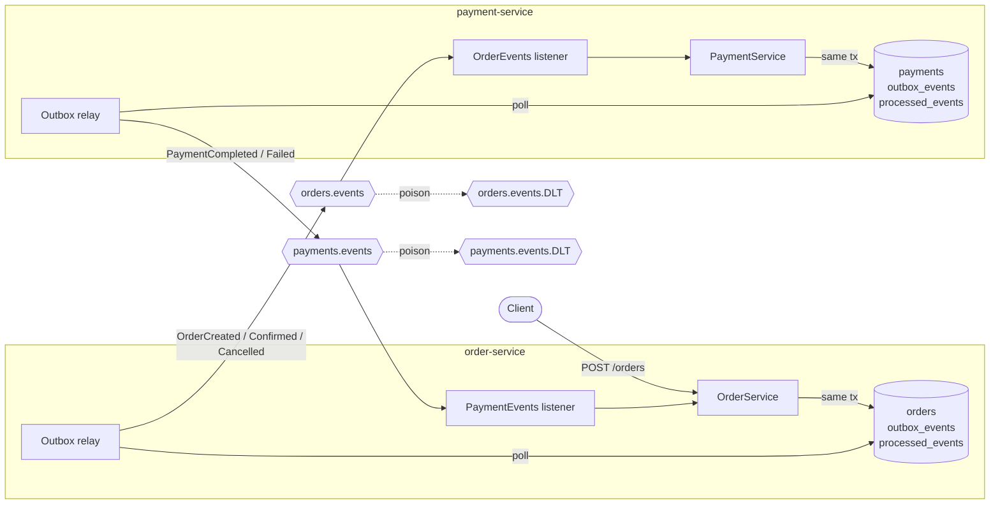
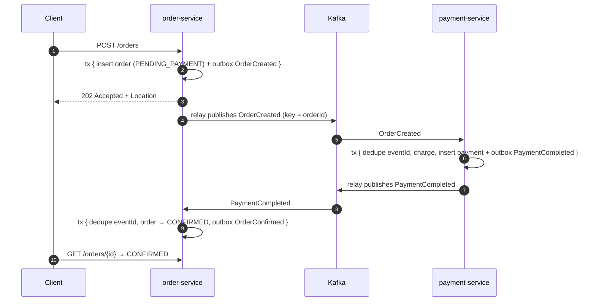

# kafka-order-flow

An event-driven order and payment system in **Kotlin + Spring Boot + Kafka**. It shows the patterns that keep a distributed workflow correct when networks fail, consumers crash and messages arrive twice:

- **Transactional outbox**: no dual writes between Postgres and Kafka
- **Idempotent consumers**: at-least-once delivery without double charging
- **Choreographed saga**: services react to each other's events, with no central orchestrator
- **Retry with backoff + dead-letter topics**: one poison message never blocks a partition
- **Per-aggregate ordering**: events are keyed by `orderId`
- **Testcontainers integration tests** against real Postgres and Kafka


---

## Architecture



Each service owns its own database. They communicate only through Kafka.

### Happy path



If the charge is declined, payment-service publishes `PaymentFailed` instead. order-service then marks the order `CANCELLED`, which is the saga's compensating step.

---

## Design decisions

| Problem | Approach | Where |
|---|---|---|
| Saving the order and publishing to Kafka can't be one atomic step (dual write) | Write the event to an `outbox_events` table **in the same DB transaction**; a relay publishes committed rows | [`OutboxWriter`](common/src/main/kotlin/dev/sankalp/orderflow/common/outbox/OutboxWriter.kt), [`OutboxRelay`](common/src/main/kotlin/dev/sankalp/orderflow/common/outbox/OutboxRelay.kt) |
| Several relay instances must not publish the same row at the same moment | `SELECT … FOR UPDATE SKIP LOCKED` in batches | `OutboxRelay` |
| Relay crash between "sent" and "marked published" re-sends events | Accept **at-least-once**; every event carries a stable `eventId` header (the outbox row id) | `OutboxRelay` |
| Duplicates must not double charge or double confirm | `processed_events (event_id, consumer)` insert with `ON CONFLICT DO NOTHING`, in the business transaction | [`IdempotencyGuard`](common/src/main/kotlin/dev/sankalp/orderflow/common/messaging/IdempotencyGuard.kt) |
| A buggy producer re-emits the same order under a new eventId | Second safety net: `UNIQUE (order_id)` on `payments` | [`PaymentService`](payment-service/src/main/kotlin/dev/sankalp/orderflow/payment/application/PaymentService.kt) |
| Events for one order must be processed in order | Kafka key = `orderId` → same partition; relay sends in creation order | `OutboxWriter` |
| Late or out-of-order results (a success after a cancel) | Domain state guards: only `PENDING_PAYMENT` orders transition; anything else is logged and ignored | [`OrderService`](order-service/src/main/kotlin/dev/sankalp/orderflow/order/application/OrderService.kt) |
| Transient failures (DB blip) | Exponential backoff retries, partition paused meanwhile | [`MessagingConfig`](common/src/main/kotlin/dev/sankalp/orderflow/common/MessagingConfig.kt) |
| Poison messages (bad JSON, missing headers) | Not retried; sent straight to `<topic>.DLT` with exception headers | `MessagingConfig` |
| Async API | `POST /orders` returns **202 Accepted**; clients poll `GET /orders/{id}` | [`OrderController`](order-service/src/main/kotlin/dev/sankalp/orderflow/order/api/OrderController.kt) |

### Message format

The record value is plain JSON. The metadata travels in headers:

| Header | Example |
|---|---|
| `eventId` | `7c1e…` (UUID, used for deduplication) |
| `eventType` | `OrderCreated` |

A topic can carry several event types. `orders.events` carries `OrderCreated`, `OrderConfirmed` and `OrderCancelled`, and consumers skip the types they don't care about.

---

## Running it

**Prerequisites:** JDK 21 and Docker.

```bash
# 1. Infrastructure: Kafka, two Postgres databases, Kafka UI on http://localhost:8080
docker compose up -d

# 2. Services (separate terminals, or run from IntelliJ)
./gradlew :order-service:bootRun
./gradlew :payment-service:bootRun

# ...or run everything in containers
docker compose --profile apps up -d --build
```

### Try it

```bash
# Approved: amounts up to 10,000 pass the fake gateway
curl -i -X POST localhost:8081/orders \
  -H 'Content-Type: application/json' \
  -d '{"customerId":"cust-42","amount":1499.00,"currency":"INR"}'

# Declined: triggers the compensating path
curl -s -X POST localhost:8081/orders \
  -H 'Content-Type: application/json' \
  -d '{"customerId":"cust-42","amount":25000.00,"currency":"INR"}'

# Check the outcome (use the id from the response)
curl -s localhost:8081/orders/<order-id>
```

Open Kafka UI at http://localhost:8080 to watch events flow through `orders.events` and `payments.events`, including the `eventId` and `eventType` headers.

### Tests

```bash
./gradlew build   # unit + Testcontainers integration tests (Docker must be running)
```

The integration tests cover these scenarios:

- An order publishes `OrderCreated` through the outbox, and outbox rows get marked as published.
- A **redelivered** `PaymentCompleted` confirms the order exactly once.
- A failed payment cancels the order, and a **late success is ignored**.
- **Duplicate and re-sent** `OrderCreated` events produce exactly one payment.
- A **poison message** lands in the DLT, and the partition keeps processing later messages.

---

## Project layout

```
common/            shared events, outbox writer + relay, idempotency guard, Kafka error handling
order-service/     REST API, order state machine, payment-result consumer      (port 8081)
payment-service/   order consumer, fake payment gateway, payment-result events (port 8082)
```

## Roadmap

- [ ] Replace polling with **CDC** (Debezium on the Postgres WAL) and compare latency and load
- [ ] **Avro + Schema Registry** for versioned contracts and compatibility checks
- [ ] **OpenTelemetry** tracing across HTTP → outbox → Kafka → consumer, with trace context in headers
- [ ] Outbox cleanup job and metrics (lag = oldest unpublished row)
- [ ] An inventory-service, to turn this into a three-step saga with reservation timeouts
- [ ] Load test with k6 plus a chaos test (kill a consumer mid-batch, verify no duplicates)

## Tech

Kotlin 2.2 · Spring Boot 3.5 · Spring Kafka · Spring Data JPA · Flyway · PostgreSQL 16 · Apache Kafka 3.9 (KRaft) · Testcontainers · Gradle Kotlin DSL · GitHub Actions
